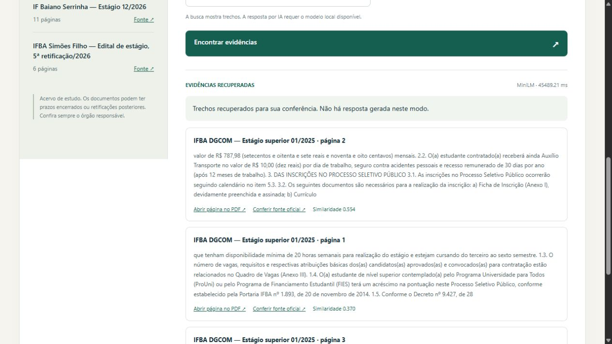
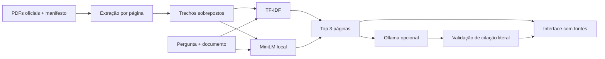

# Edital Inteligente

**Consulte editais públicos e confira as páginas que sustentam cada resultado.**

Aplicação local de IA aplicada: ingestão de PDFs, recuperação por TF-IDF e embeddings multilíngues, avaliação reproduzível e integração opcional com um LLM local. Evolução do [rastreador de editais](https://github.com/ProgrammerGV/INF032-Programa-o_Python/tree/main/projeto/rastreador-editais), por Gabriel Vinicius.



## O que já faz

- Consulta cinco PDFs oficiais, com extração por página, URL e hash da versão utilizada.
- Compara busca por palavras (TF-IDF) e por significado (MiniLM multilíngue).
- Mostra trechos e abre a página física correspondente no PDF.
- Mantém a busca disponível quando a geração local não está operacional.
- Avalia recuperação e latência com dez perguntas de desenvolvimento e vinte de teste.

**Estado da geração:** integração Ollama implementada, mas validação com Llama 3.2 1B pendente neste computador. O modo disponível sem Ollama é **busca com evidências**, não um RAG completo validado. Os modelos pré-treinados são integrados; não foi treinado um LLM próprio.

## Executar no Windows

Requer Python 3.12+ com `python --version` funcional. O primeiro preparo instala dependências e baixa os PDFs; a opção semântica também baixa um modelo. Não há uso de API paga.

```powershell
# Na raiz do repositório:
.\scripts\start.ps1 -Semantic
# Abra http://127.0.0.1:5000
```

Caso o PowerShell bloqueie scripts, use os comandos Python abaixo, sem alterar políticas de segurança.

```powershell
python -m venv .venv
.\.venv\Scripts\python -m pip install -r requirements-semantic.txt
.\.venv\Scripts\python scripts/download_corpus.py
.\.venv\Scripts\python scripts/build_corpus.py
.\.venv\Scripts\python scripts/download_model.py
.\.venv\Scripts\python app.py
```

Se um servidor de origem apresentar cadeia de certificados incompatível com o Python, use o download HTTPS nativo do Windows, mantendo a validação de certificados:

```powershell
New-Item -ItemType Directory -Force data/pdfs | Out-Null
Get-Content data/manifest.json -Raw | ConvertFrom-Json | ForEach-Object {
  Invoke-WebRequest -Uri $_.url -OutFile (Join-Path data/pdfs ($_.id + '.pdf'))
}
.\.venv\Scripts\python scripts/download_corpus.py
.\.venv\Scripts\python scripts/build_corpus.py
```

Depois do preparo, a aplicação não precisa de internet: o carregamento semântico usa arquivos locais. Para usar somente TF-IDF, instale `requirements.txt` e omita o download do modelo. O corpus extraído acompanha o código; os PDFs devem ser baixados para abrir a página original.

## Geração opcional

Instale [Ollama pela fonte oficial](https://ollama.com/download), prepare `ollama pull llama3.2:1b` e mantenha o serviço local ativo. Marque “Consultar modelo local” na interface. A integração usa exclusivamente `127.0.0.1:11434`, sem envio a APIs externas.

Para limitar afirmações não sustentadas, a saída do modelo é uma seleção de citações literais: cada trecho precisa existir na fonte recuperada e citar um ID válido. Não é uma síntese livre. Essa validação não garante que a citação seja relevante ou suficiente para responder; a conferência humana continua necessária.

## Arquitetura



Não há OCR, treinamento de LLM, seleção automática de retificações ou validação de elegibilidade de candidatos. Há páginas com fontes/codificações imperfeitas e tabelas cuja ordem é prejudicada pela extração. Sempre conferir o PDF original e o órgão responsável.

## API

- `GET /api/documents`: documentos e disponibilidade dos arquivos do modelo semântico.
- `POST /api/ask`: `question` (5–600 caracteres), `method` (`tfidf` ou `semantic`), `document_id` opcional e `generate` booleano.
- Resposta: `answer`, `status`, `mode`, `sources`, `claims`, `generation_attempted` e `latency_ms`.
- `GET /documents/<id>.pdf`: PDF local; a interface usa `#page=N`.
- Sem modelo semântico: HTTP 503 explícito, sem substituição silenciosa do método. Sem geração: fontes preservadas e estado `generation_unavailable`.

Exemplo:

```json
{"question":"Qual é o valor mensal da bolsa?","document_id":"ifba-dgcom-2025","method":"tfidf","generate":false}
```

## Testes e avaliação

```powershell
python -m pip install -r requirements-dev.txt
python -m pytest -q
python scripts/evaluate.py --split dev
python scripts/evaluate.py --split test
```

Consulte [o protocolo](evaluation/README.md), os [relatórios reais](reports/) e o [artigo técnico](docs/artigo.md). Similaridade não é probabilidade de correção. Hit@3 mede recuperação de página, não acerto da resposta. A revisão humana de respostas geradas é uma etapa separada e não recebe valores fictícios.

O servidor local usa Waitress e escuta apenas em loopback. Docker é uma alternativa para o modo TF-IDF (`docker build -t edital-inteligente .` e `docker run --rm -p 127.0.0.1:5000:5000 edital-inteligente`). A imagem não inclui MiniLM nem Ollama; esse caminho não substitui a avaliação local.

## Origem, progresso e limites

- [Origem e atribuição](ORIGIN.md)
- [Progresso e critérios de aceite](docs/progresso.md)
- [Roteiro de demonstração](docs/demo.md)
- [Modelo de embeddings](https://huggingface.co/sentence-transformers/paraphrase-multilingual-MiniLM-L12-v2) — parâmetros pré-treinados, não treinamento próprio.

Projeto de portfólio e estudo, sem vínculo com iFood ou com os órgãos dos editais. Não há comprovação de usuários em produção ou horas economizadas. A implementação contou com assistência de IA.
