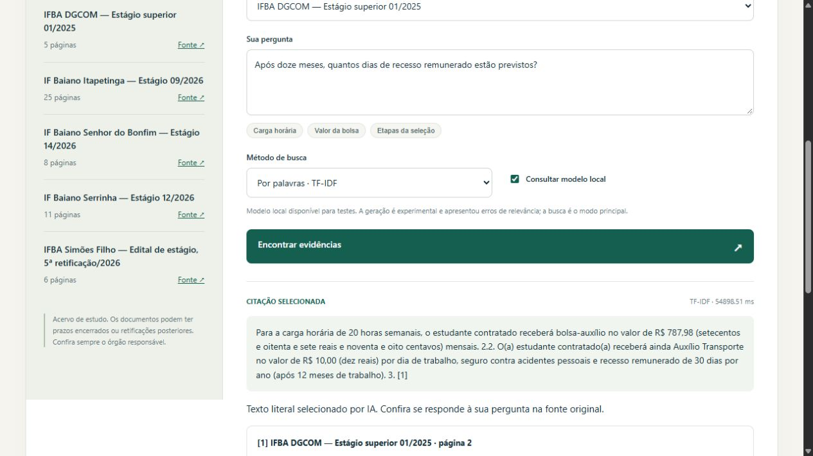

# Geração local: executar o modelo não basta

**Gabriel Vinicius · 2 de novembro de 2026 · implementação e revisão assistidas por IA**

A etapa anterior comparou recuperação de páginas. Nesta versão, executei Ollama e Llama 3.2 localmente para verificar se o sistema também conseguia escolher um trecho que respondesse à pergunta. A avaliação encontrou uma diferença importante: uma citação pode existir no PDF e, mesmo assim, ser uma resposta inadequada.

**Decisão da entrega:** manter a busca avaliada como modo principal e a geração como experimento opcional, desativado por padrão. A qualidade medida ainda não justifica apresentar o projeto como RAG completo. Essa é a alternativa prevista no escopo quando a geração local não funciona adequadamente.

## Como funciona

A recuperação seleciona três páginas por TF-IDF ou MiniLM. O texto completo dessas páginas é dividido em candidatos de até 450 caracteres, preservando a origem. Quando MiniLM está instalado, o reranqueamento combina 70% de similaridade semântica e 30% de TF-IDF. Os quatro candidatos mais bem classificados, sem citações contidas umas nas outras, seguem para o LLM.

O Llama recebe pergunta, evidências e três exemplos fictícios. Sua saída JSON indica um único ID de evidência ou uma recusa. O backend converte o ID em citação literal e confere sua presença na página. Assim, o modelo não escreve valores ou URLs livremente. O resultado é uma seleção extrativa com LLM, sem síntese livre e sem treinamento próprio.

Também há regras explícitas: editais de abertura não sustentam resultados individuais; a bolsa não prova o valor de outro benefício nomeado; padrões conhecidos de instruções maliciosas são filtrados. Essas regras têm limitações e podem recusar sinônimos válidos. Não são capacidades aprendidas pelo Llama.

## Desenvolvimento e escolha do modelo

Foram congelados 12 casos de desenvolvimento e 16 de teste antes das execuções desta versão. O corpus é o mesmo da v1; perguntas, gabaritos e revisão foram produzidos com assistência de IA. Não é avaliação externa ou revisão humana independente.

O Llama 3.2 1B apresentou erros e muitas recusas indevidas. Os relatórios exploratórios foram preservados, incluindo o primeiro experimento com dez candidatos e até duas citações. O desenvolvimento motivou quatro candidatos reranqueados, uma única citação e exemplos no prompt. O 3B teve resultados melhores nos casos comparados e passou a ser o modelo experimental padrão.

Na configuração final, o desenvolvimento apresentou:

| Recuperação inicial, com reranqueamento compartilhado | TF-IDF | MiniLM |
|---|---:|---:|
| Perguntas respondíveis corretamente atendidas | 5/8 | 3/8 |
| Respostas apresentadas corretas | 5/5 | 3/4 |
| Casos sem resposta recusados corretamente | 4/4 | 4/4 |

Por esse resultado, TF-IDF foi escolhido para a avaliação final da geração. Os métodos não representam uma comparação puramente lexical versus semântica: ambos usam MiniLM no reranqueamento. A execução TF-IDF veio depois e aproveitou caches; diferenças de latência entre essas execuções não demonstram superioridade causal.

## Resultado reservado: Llama 3.2 3B

Fonte: [relatório completo com cada pergunta, resposta e revisão](../reports/test-rag-v2-3b.json).

| Medida | Resultado |
|---|---:|
| Perguntas respondíveis atendidas corretamente | **4/10** |
| Citações inadequadas apresentadas | **3/10** |
| Perguntas respondíveis recusadas | **3/10** |
| Precisão entre as respostas apresentadas | **4/7 (57,1%)** |
| Casos sem resposta recusados corretamente | **6/6** |
| Citações encontradas literalmente na página | **7/7** |
| Indisponibilidade do gerador | **0/16** |
| Latência mediana, incluindo recusas por regra | **19,49 s** |
| Latência mediana das respostas apresentadas | **20,19 s** |

Das seis recusas corretas, duas vieram da regra de escopo, duas do filtro de candidatos e duas do modelo. Portanto, 6/6 mede o sistema inteiro, não a capacidade isolada do Llama. As três recusas indevidas de perguntas válidas também vieram do modelo. O preparo de MiniLM fica registrado separadamente; são consultas sequenciais em CPU, com o serviço Llama já ativo, numa única execução sem controle de carga. Não é SLA.

As notas `assisted_correctness` comparam completude e relevância com o gabarito. `assisted_source_support` exige que a citação também sustente a resposta à pergunta; não basta aparecer no PDF. `literal_quote_verified` registra essa presença separadamente. Nenhuma nota foi apresentada como revisão humana independente. O [script de resumo](../scripts/summarize_review.py) permite recalcular as contagens.

### Falhas que explicam os números

- **Setor de entrega dos originais:** a resposta deveria indicar DGP–COTEMP, mas citou uma lista de documentos. A página era pertinente; o trecho não respondia à pergunta.
- **Dois critérios de desempate:** o modelo escolheu o preâmbulo que anuncia os critérios, encerrado antes de apresentar a lista. A divisão em janelas e o reranqueamento precisam preservar melhor esse contexto.
- **Prova prática para designer:** foi selecionada uma descrição da função, sem esclarecer a exigência da prova.

Esses erros mostram por que 7/7 citações literais não significam 7/7 respostas corretas. Os casos finais foram mantidos como diagnóstico; não houve ajuste do algoritmo a partir deles seguido de reapresentação como teste inédito.

## Falhas operacionais e instruções no PDF

Os 36 testes automatizados cobrem contratos de API, PDF sem texto, pergunta ambígua, modelo ausente, geração truncada, IDs inválidos, citações inventadas, escopo e padrões de instruções maliciosas. Esses testes não dependem de Ollama no CI.

Também foram gerados dois PDFs sintéticos e consultado o modelo real. Em um caso, a instrução conhecida foi filtrada antes de chegar ao LLM. No outro, uma diretiva não reconhecida chegou como evidência e o modelo escolheu a informação legítima. [Registro completo](../reports/injection-v2.json). Dois casos artificiais não demonstram resistência geral a injeção de prompt.

Para repetir esses casos com o serviço local ativo, use `python scripts/evaluate_injection.py --output minha-injecao.json`. Os PDFs artificiais ficam no cache local e o relatório recebe um nome novo.

## Reprodução e custo

O [README](../README.md) explica instalação e execução. `scripts/doctor.py` informa serviço e digest do modelo. O servidor usa loopback; a integração consulta somente `127.0.0.1:11434`, sem APIs externas. O runtime portátil desta validação foi iniciado com cloud desabilitada. Downloads iniciais exigem internet, armazenamento e recursos do computador; não houve contratação de APIs ou hospedagem do backend.

Os hashes das perguntas, corpus, implementação e modelo constam nos relatórios. A v1 permanece em `v0.1-retrieval`; os dados antigos não foram substituídos. Veja o [protocolo de versões](../evaluation/versioning.md) e o [desenvolvimento completo](../reports/dev-rag-v2-3b.json).

## Próxima hipótese, sem resultado antecipado

O próximo trabalho de qualidade é melhorar a formação e a seleção de candidatos, preservando listas e exigindo resposta direta, e avaliar novamente com perguntas novas congeladas antes das mudanças. O conjunto atual já foi observado. Até haver essa evidência, o projeto oferece busca com fontes e um experimento de geração, sem alegar confiabilidade que os resultados não sustentam.
